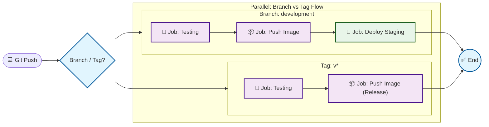
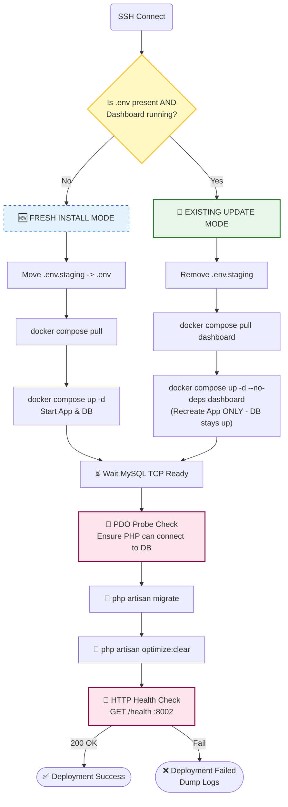
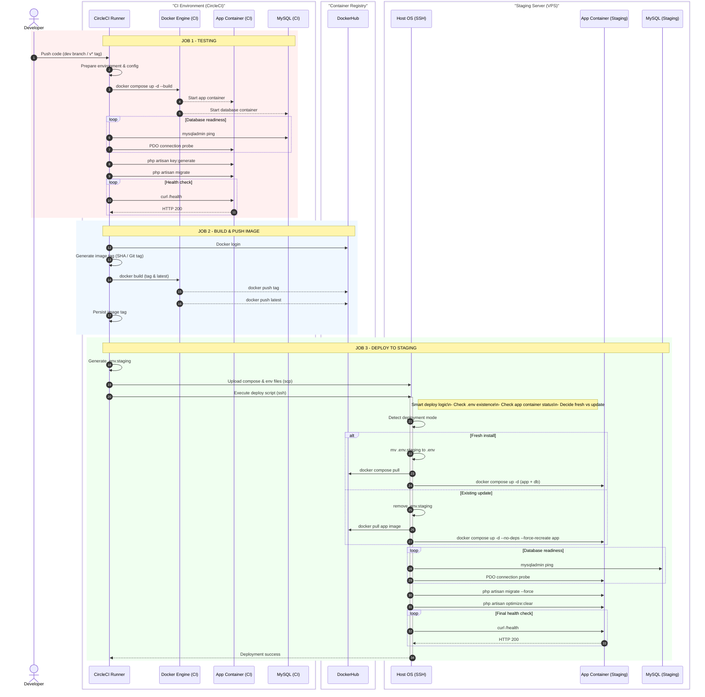

# 🚀 CI/CD Pipeline: Laravel + Docker + CircleCI (Smart Deploy)


This pipeline automates the **Testing**, **Docker Image Build & Push**, and **Deployment** processes for a Docker-based Laravel application to a **Staging (VPS)** server.

**Key Feature: Smart Deployment Detection** — the pipeline distinguishes between two scenarios:

* **Fresh Install**: New server / missing `.env` / application container not running.
* **Routine Update**: Server previously deployed, Database remains active, only the application container is recreated.

This approach ensures routine updates minimize database downtime (Zero-Downtime Database).

---

## 📋 Table of Contents | [](README.INA.md)

1. [Architecture & Diagrams](#architecture--diagrams)
2. [Prerequisites](#prerequisites)
3. [File Structure](#file-structure)
4. [Environment Variables (Contexts)](#environment-variables-contexts)
5. [Server Setup (VPS)](#server-setup-vps)
6. [Project Setup (Docker & Laravel)](#project-setup-docker--laravel)
7. [Usage Guide](#usage-guide)
8. [Customization Guide (Other Projects)](#customization-guide-other-projects)
9. [Troubleshooting](#troubleshooting)
10. [Security Notes](#security-notes)
11. [Local Test (Local CircleCI Simulation)](#local-test-local-circleci-simulation)


---

## 📊 Architecture & Diagrams | [](README.INA.md)

### 1) High-Level Pipeline (Parallel Jobs: Branch vs Tag)



### 2) Smart Deploy (Job: Deploy-Staging)

**Detection Rules (based on script):**

* **Fresh install**: `.env` is missing OR dashboard container is NOT RUNNING.
* **Existing**: `.env` exists AND dashboard container is RUNNING.



### 3) Sequence Diagram: CircleCI → DockerHub → VPS



---

## 🛠 Prerequisites | [](README.INA.md)

### 1) VPS Server

* OS: Ubuntu/Debian recommended.
* Installed:
* Docker Engine
* Docker Compose v2 (`docker compose version`)


* Deploy user should be able to run docker without sudo (recommended):
```bash
sudo usermod -aG docker ubuntu
# logout/login required

```


### 2) CircleCI

* Project uses config **v2.1**.
* SSH deploy key is configured (see setup section).

### 3) Laravel Application

* Has a `GET /health` endpoint returning **HTTP 200** when healthy.
* The `dashboard` image must have `curl` installed (required for health-checks).

---

## 📂 File Structure | [](README.INA.md)

Minimum required files:

```text
├── .circleci/
│   ├── config.yml                # CI/CD Script
│   └── local_circleci_test.sh    # Local CI simulation
├── docker-compose.yml            # Service Definition
├── dockerfile                    # Laravel Image Build
├── .env.example                  # Template env for CI
└── makefile                      # (optional) helper

```

---

## 🔐 Environment Variables (Contexts) | [](README.INA.md)

Use **Contexts** in CircleCI for security and reusability.

### Context: `dockerhub`

| Variable | Description |
| --- | --- |
| `DOCKERHUB_USERNAME` | DockerHub username |
| `DOCKERHUB_TOKEN` | DockerHub access token (recommended, do not use password) |
| `DOCKERHUB_REPO` | Image repo, e.g., `myuser/yotta-dashboard` |

### Context: `deploy_server`

| Variable | Description |
| --- | --- |
| `SERVER_IP` | Public VPS IP |
| `SERVER_USER` | SSH user (e.g., `ubuntu`) |
| `DB_DATABASE` | Database name |
| `DB_USERNAME` | Database user |
| `DB_PASSWORD` | Database password |
| `MYSQL_ROOT_PASSWORD` | (optional) default script: `root` |

> Note: `APP_KEY` is generated during deployment (fresh install) and saved to `.env`.

---

## 🖥 Server Setup (VPS) | [](README.INA.md)

### 1) Install Docker + Compose v2

Ensure:

```bash
docker --version
docker compose version

```

### 2) Setup SSH Key for CircleCI

1. Generate key (locally):
```bash
ssh-keygen -t ed25519 -C "circleci-deploy" -f circleci_deploy_key

```


2. Add public key to server:
* Append the content of `circleci_deploy_key.pub` to:
```bash
~/.ssh/authorized_keys

```


3. Add private key to CircleCI:
* Project Settings → **SSH Keys** → **Add Private Key**
* Paste content of `circleci_deploy_key`
* Copy fingerprint → add to `.circleci/config.yml` under `add_ssh_keys.fingerprints`


### 3) Open Port

Open firewall port:

* `8002/tcp` (matches `ports: "8002:8002"`)

---

## 🐳 Project Setup (Docker & Laravel) | [](README.INA.md)

### 1) Dockerfile (Must have curl)

Minimal example:

```dockerfile
RUN apt-get update && apt-get install -y curl && rm -rf /var/lib/apt/lists/*

```

### 2) docker-compose.yml (Recommended)

For `docker compose pull dashboard` to work effectively, the `dashboard` service should use an image variable:

```yaml
services:
  dashboard:
    image: ${DOCKERHUB_REPO}:${IMAGE_TAG:-latest}
    build:
      context: .
      dockerfile: dockerfile
    ports:
      - "8002:8002"
    env_file:
      - .env
    depends_on:
      - mysql

```

> If `image:` is missing, deploy will still work, but `pull` becomes ineffective and `--no-build` might prevent image updates.

---

## 🚀 Usage Guide | [](README.INA.md)

### A) Routine Deploy (branch `development`)

Push to `development`:

```bash
git checkout development
git add .
git commit -m "feat: update"
git push origin development

```

Result:

* Testing → push image tag `sha-xxxxxxx` → deploy to staging.

### B) Release Tag (v*)

```bash
git tag v1.0.0
git push origin v1.0.0

```

Result:

* Testing → push image `v1.0.0` and `latest`.
* (Deploy for tags is optional; can be added to the workflow).

### C) Force Fresh Install (Reset)

On the server:

```bash
cd /home/ubuntu/dev-yotta
mv .env .env.bak
docker compose down

```

Then rerun the workflow in CircleCI → deployment will be treated as a fresh install.

---

## 🔧 Customization Guide | [](README.INA.md)

Common things to customize:

1. **SSH Fingerprint**
`.circleci/config.yml` → `add_ssh_keys.fingerprints`
2. **Server BASE_DIR**
Default: `/home/ubuntu/dev-yotta`
3. **Compose Service Names**
If services are not named `dashboard` / `mysql`, update all commands calling:
* `docker compose ... dashboard`
* `docker compose ... mysql`


4. **Health Check Port**
Change `INTERNAL_PORT=8002` to match your app's internal port.
5. **Health Endpoint**
If endpoint is not `/health`, update the curl URL.

---

## ❓ Troubleshooting | [](README.INA.md)

| Issue | Symptom / Error | Common Cause | Fix (Quick Steps) |
| --- | --- | --- | --- |
| Unclosed `<<` tag | `Unclosed '<<' tag` / `('<<' must be escaped as '\<<' in config v2.1+)` | CircleCI v2.1+ treats `<<` as special syntax | Use escaped heredoc: `\<<EOF` and `\<<'EOSH'`, then `circleci config validate` |
| YAML parse error | `Unable to parse YAML` / `could not find expected ':'` | Wrong YAML indentation / heredoc "bleeding" into YAML levels | Ensure `command: |
| Config file not found | `open .circleci/config.yml: no such file or directory` | Running validate not from repo root / wrong path | Run from root or use: `circleci config validate .circleci/config.yml` |
| Health Check Failed | Status not 200 (e.g., 500 / 000) | Wrong port, missing endpoint, app crash, or missing `curl` | 1) Check `INTERNAL_PORT` 2) `docker compose logs --tail=200 dashboard` 3) Ensure `curl` exists in image |
| `curl: not found` in container | Health check fails with `curl: not found` | Dashboard image missing curl | Add to Dockerfile: `apt-get install -y curl` then rebuild/push |
| MySQL not ready / migration refused | `SQLSTATE[HY000] [2002] Connection refused` | MySQL not ready / wrong credential / low server resources | Check: `docker compose logs --tail=200 mysql`, verify DB env, use `mysql:8.0` |
| Migration failed | `php artisan migrate` error | Wrong credential / migration conflict / permission | Check `.env` on server, run manually: `docker compose exec -T dashboard php artisan migrate --force` |
| Permission denied (SSH) | `Permission denied (publickey)` | SSH key missing / wrong fingerprint / wrong user | Ensure pubkey in `authorized_keys`, fingerprint matches, `SERVER_USER` is correct |
| Docker/Compose missing on server | `Docker missing` / `docker compose v2 missing` | Docker not installed / compose is v1 | Install Docker Engine + compose v2, check `docker compose version` |
| Deploy does not update image | Deploy success but app version unchanged | `docker-compose.yml` does not use `image: ${DOCKERHUB_REPO}:${IMAGE_TAG}` | Add image variable to dashboard service and redeploy |
| Port 8002 not accessible publicly | `curl localhost:8002` OK, but timeout from outside | Firewall/security group blocking port | Open `8002/tcp` in UFW / security group then test externally |

---

## 🔒 Security Notes | [](README.INA.md)

* Do not expose MySQL port to the public.
* Use DockerHub Access Token (not password).
* Store secrets in CircleCI Contexts (not in the repo).
* Use a dedicated deploy key (not a personal SSH key).

---

## 🧪 Local Test (Local CircleCI Simulation) | [](README.INA.md)

Before pushing to the repository, you can simulate the pipeline locally using this helper script:

**Script:** `.circleci/local_circleci_test.sh`

### 🧱 Note: Image Build is Separate (Recommended)

By default, the script **does not build** the image to keep testing fast and avoid unnecessary rebuilds.

Recommended workflow:

1. **Build image once** (manually):
```bash
docker build -t yotta-iot-dashboard:latest -f dockerfile .

```


2. Run CircleCI simulation:
```bash
chmod +x .circleci/local_circleci_test.sh
./.circleci/local_circleci_test.sh

```


> If you want the script to build as well, use `BUILD=1` (see options table below).


### What does this script do?

1. **Config Validation**: Runs `circleci config validate` (if CircleCI CLI is installed).
2. **Setup Environment**:
* Backs up original `.env` (if exists).
* Generates a new `.env` mimicking the CI environment (DB host `mysql`, CI credentials, generates valid `APP_KEY`).


3. **Start Container**:
* Runs `docker compose up` (default: **without rebuild**).
* **Forces recreate** of `dashboard` container to ensure `.env` (`env_file`) is properly loaded.


4. **Wait for DB**: Loops checking `mysqladmin ping` until MySQL is ready.
5. **Inject Env**: Copies host `.env` to `/var/www/.env` inside the container (required for some artisan commands).
6. **Validate Laravel**: Runs `php artisan migrate` + `php artisan optimize:clear`.
7. **Health Check**: Curls `/health` endpoint from inside the container.
8. **Restore**: Restores the original `.env` after completion (**unless** `KEEP_ENV=1`).

### ▶️ How to run

From repo root:

```bash
chmod +x .circleci/local_circleci_test.sh
./.circleci/local_circleci_test.sh

```

### ⚙️ Configuration options

| Variable | Function | Command Example |
| --- | --- | --- |
| `BUILD=1` | Force rebuild image | `BUILD=1 ./.circleci/local_circleci_test.sh` |
| `CLEANUP_ON_EXIT=1` | Remove container & volume on exit | `CLEANUP_ON_EXIT=1 ./.circleci/local_circleci_test.sh` |
| `KEEP_ENV=1` | Do not restore old `.env` (for debugging) | `KEEP_ENV=1 ./.circleci/local_circleci_test.sh` |
| `INTERNAL_PORT` | Override port (default: `8002`) | `INTERNAL_PORT=8000 ./.circleci/local_circleci_test.sh` |
| `HEALTH_PATH` | Override path (default: `/health`) | `HEALTH_PATH=/healthz ./.circleci/local_circleci_test.sh` |

### 🔄 Total reset (clean database)

Since MySQL uses a volume (`db_data`), data persists. To reset completely:

```bash
docker compose down -v --remove-orphans
./.circleci/local_circleci_test.sh

```

### ⚠️ Important notes

* Script relies on `container_name` in `docker-compose.yml`:
* Dashboard: `yotta-dashboard`
* MySQL: `yotta-mysql`


* The `dashboard` image must contain `curl`.
* The `/health` endpoint must return **HTTP 200**.