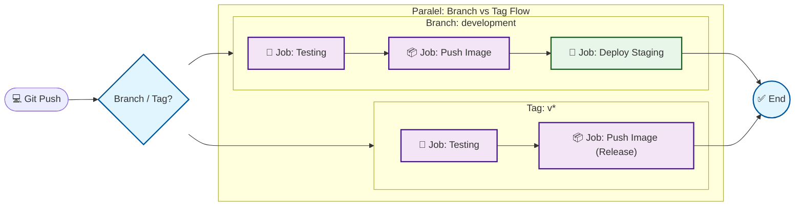
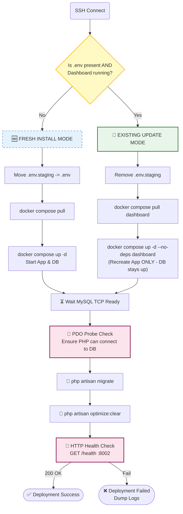
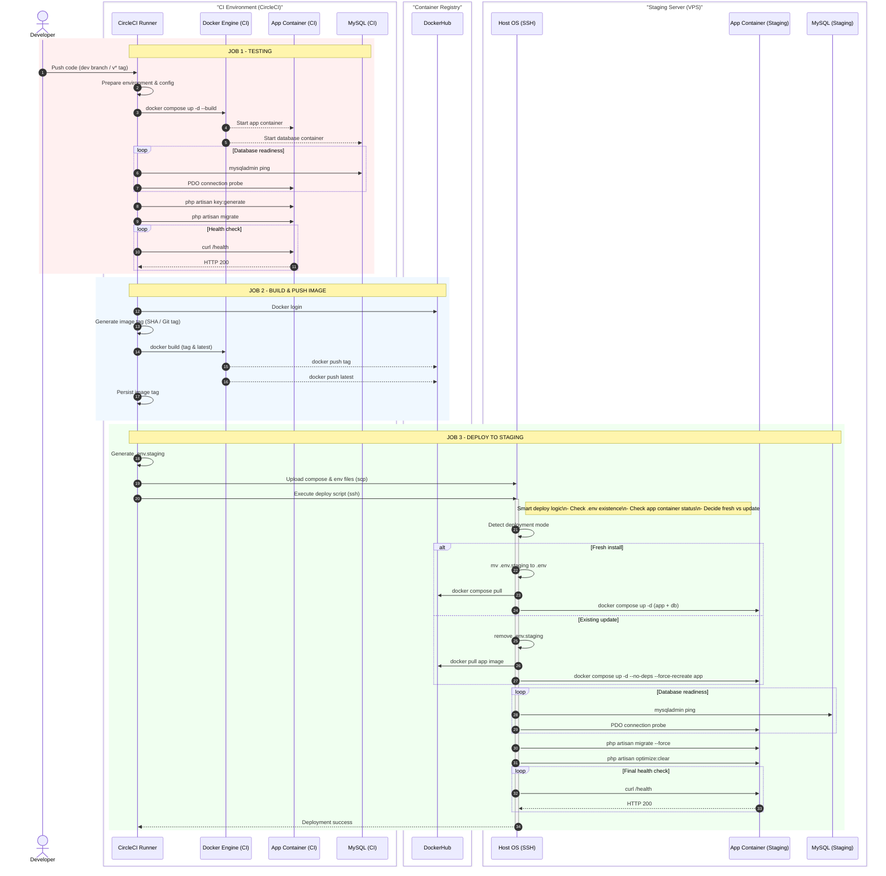

# 🚀 CI/CD Pipeline: Laravel + Docker + CircleCI (Smart Deploy)


Pipeline ini mengotomasi proses **Testing**, **Docker Image Build & Push**, dan **Deployment** aplikasi Laravel berbasis Docker ke server **Staging (VPS)**.

**Fitur utama: Smart Detection Deployment** — pipeline membedakan dua kondisi:

* **Fresh Install**: server baru / `.env` hilang / container app tidak running
* **Routine Update**: server sudah pernah deploy, DB tetap hidup, hanya container app yang di-recreate

Dengan ini, update rutin meminimalkan downtime database.

---

## 📋 Table of Contents | [](README.ENG.md)

1. [Architecture & Diagrams](#architecture--diagrams)
2. [Prerequisites](#prerequisites)
3. [File Structure](#file-structure)
4. [Environment Variables (Contexts)](#environment-variables-contexts)
5. [Server Setup (VPS)](#server-setup-vps)
6. [Project Setup (Docker & Laravel)](#project-setup-docker--laravel)
7. [Usage Guide](#usage-guide)
8. [Customization Guide (Other Projects)](#customization-guide-other-projects)
9. [Troubleshooting](#troubleshooting)
10. [Security Notes](#security-notes)
11. [Local Test (Local CircleCI Simulation)](#local-test-local-circleci-simulation)

---

## 📊 Architecture & Diagrams | [](README.ENG.md)

### 1) High-Level Pipeline (Parallel Jobs: Branch vs Tag)



### 2) Smart Deploy (Job: Deploy-Staging)

**Detection Rules (sesuai script):**

* **Fresh install**: `.env` tidak ada ATAU dashboard container tidak RUNNING
* **Existing**: `.env` ada DAN dashboard container RUNNING



### 3) Sequence Diagram: CircleCI → DockerHub → VPS



---

## 🛠 Prerequisites  | [](README.ENG.md)

### 1) VPS Server

* OS: Ubuntu/Debian recommended.
* Installed:
* Docker Engine
* Docker Compose v2 (`docker compose version`)


* Deploy user bisa run docker tanpa sudo (recommended):
```bash
sudo usermod -aG docker ubuntu
# logout/login required

```


### 2) CircleCI

* Project menggunakan config **v2.1**
* SSH deploy key sudah dikonfigurasi (lihat bagian setup)

### 3) Laravel Application

* Punya endpoint `GET /health` return **HTTP 200** saat sehat
* Image `dashboard` punya `curl` (dibutuhkan health-check)

---

## 📂 File Structure  | [](README.ENG.md)

Minimum file yang dibutuhkan:

```text
├── .circleci/
│   ├── config.yml                # CI/CD Script
│   └── local_circleci_test.sh    # Local CI simulation
├── docker-compose.yml            # Service Definition
├── dockerfile                    # Laravel Image Build
├── .env.example                  # Template env for CI
└── makefile                      # (optional) helper

```

---

## 🔐 Environment Variables (Contexts)

Gunakan **Contexts** di CircleCI untuk keamanan dan reuse.

### Context: `dockerhub`

| Variable | Description |
| --- | --- |
| `DOCKERHUB_USERNAME` | DockerHub username |
| `DOCKERHUB_TOKEN` | DockerHub access token (recommended, jangan pakai password) |
| `DOCKERHUB_REPO` | Image repo, contoh: `myuser/yotta-dashboard` |

### Context: `deploy_server`

| Variable | Description |
| --- | --- |
| `SERVER_IP` | Public VPS IP |
| `SERVER_USER` | SSH user (contoh: `ubuntu`) |
| `DB_DATABASE` | Database name |
| `DB_USERNAME` | Database user |
| `DB_PASSWORD` | Database password |
| `MYSQL_ROOT_PASSWORD` | (optional) default script: `root` |

> Note: `APP_KEY` di-generate saat deploy (fresh install) dan disimpan ke `.env`.

---

## 🖥 Server Setup (VPS)  | [](README.ENG.md)

### 1) Install Docker + Compose v2

Pastikan:

```bash
docker --version
docker compose version

```

### 2) Setup SSH Key untuk CircleCI

1. Generate key (di lokal):
```bash
ssh-keygen -t ed25519 -C "circleci-deploy" -f circleci_deploy_key

```


2. Add public key ke server:
* Append isi `circleci_deploy_key.pub` ke:
```bash
~/.ssh/authorized_keys

```


3. Add private key ke CircleCI:
* Project Settings → **SSH Keys** → **Add Private Key**
* Paste isi `circleci_deploy_key`
* Copy fingerprint → masukkan ke `.circleci/config.yml` di bagian `add_ssh_keys.fingerprints`


### 3) Open Port

Buka port firewall:

* `8002/tcp` (sesuai `ports: "8002:8002"`)

---

## 🐳 Project Setup (Docker & Laravel)

### 1) Dockerfile (wajib ada curl)

Contoh minimal:

```dockerfile
RUN apt-get update && apt-get install -y curl && rm -rf /var/lib/apt/lists/*

```

### 2) docker-compose.yml (recommended)

Agar `docker compose pull dashboard` efektif, service `dashboard` sebaiknya pakai image variable:

```yaml
services:
  dashboard:
    image: ${DOCKERHUB_REPO}:${IMAGE_TAG:-latest}
    build:
      context: .
      dockerfile: dockerfile
    ports:
      - "8002:8002"
    env_file:
      - .env
    depends_on:
      - mysql

```

> Jika `image:` tidak ada, deploy tetap jalan, tetapi `pull` jadi tidak efektif dan `--no-build` bisa menghambat update image.

---

## 🚀 Usage Guide  | [](README.ENG.md)

### A) Routine Deploy (branch `development`)

Push ke `development`:

```bash
git checkout development
git add .
git commit -m "feat: update"
git push origin development

```

Hasil:

* Testing → push image tag `sha-xxxxxxx` → deploy ke staging

### B) Release Tag (v*)

```bash
git tag v1.0.0
git push origin v1.0.0

```

Hasil:

* Testing → push image `v1.0.0` dan `latest`
* (Deploy untuk tags opsional, bisa ditambahkan ke workflow)

### C) Force Fresh Install (Reset)

Di server:

```bash
cd /home/ubuntu/dev-yotta
mv .env .env.bak
docker compose down

```

Lalu rerun workflow di CircleCI → deploy akan dianggap fresh install.

---

## 🔧 Customization Guide (Other Projects)  | [](README.ENG.md)

Hal yang biasanya diganti:

1. **SSH Fingerprint**
`.circleci/config.yml` → `add_ssh_keys.fingerprints`
2. **Server BASE_DIR**
Default: `/home/ubuntu/dev-yotta`
3. **Compose Service Names**
Kalau service bukan `dashboard` / `mysql`, update semua command yang memanggil:
* `docker compose ... dashboard`
* `docker compose ... mysql`


4. **Health Check Port**
Ubah `INTERNAL_PORT=8002` sesuai port internal app
5. **Health Endpoint**
Kalau endpoint bukan `/health`, update URL curl

---

## ❓ Troubleshooting  | [](README.ENG.md)

| Issue | Symptom / Error | Common Cause | Fix (Quick Steps) |
| --- | --- | --- | --- |
| Unclosed `<<` tag | `Unclosed '<<' tag` / `('<<' must be escaped as '\<<' in config v2.1+)` | CircleCI v2.1+ treat `<<` sebagai syntax khusus | Gunakan heredoc yang di-escape: `\<<EOF` dan `\<<'EOSH'`, lalu `circleci config validate` |
| YAML parse error | `Unable to parse YAML` / `could not find expected ':'` | Indentasi YAML salah / heredoc “bleeding” ke level YAML | Pastikan block `command: |
| Config file not found | `open .circleci/config.yml: no such file or directory` | Jalanin validate bukan dari root repo / path salah | Jalankan dari root atau pakai: `circleci config validate .circleci/config.yml` |
| Health Check Failed | Status bukan 200 (misal 500 / 000) | Port salah, endpoint tidak ada, app crash, atau `curl` tidak ada | 1) Pastikan `INTERNAL_PORT` benar 2) `docker compose logs --tail=200 dashboard` 3) pastikan `curl` ada di image |
| `curl: not found` in container | Health check gagal `curl: not found` | Image dashboard tidak punya curl | Tambahkan di Dockerfile: `apt-get install -y curl` lalu rebuild/push |
| MySQL not ready / migration refused | `SQLSTATE[HY000] [2002] Connection refused` | MySQL belum siap / credential salah / resource server kurang | Cek: `docker compose logs --tail=200 mysql`, pastikan env DB benar, gunakan `mysql:8.0` |
| Migration failed | `php artisan migrate` error | Credential salah / migrasi conflict / permission | Cek `.env` di server, jalankan manual: `docker compose exec -T dashboard php artisan migrate --force` |
| Permission denied (SSH) | `Permission denied (publickey)` | SSH key belum dipasang / fingerprint salah / user salah | Pastikan pubkey ada di `authorized_keys`, fingerprint match, `SERVER_USER` benar |
| Docker/Compose missing on server | `Docker missing` / `docker compose v2 missing` | Docker belum terinstall / compose masih v1 | Install Docker Engine + compose v2, cek `docker compose version` |
| Deploy tidak update image | Deploy sukses tapi versi app tidak berubah | `docker-compose.yml` tidak pakai `image: ${DOCKERHUB_REPO}:${IMAGE_TAG}` | Tambahkan image variable di service dashboard lalu redeploy |
| Port 8002 tidak bisa diakses publik | `curl localhost:8002` OK, tapi dari luar timeout | Firewall/security group block port | Buka `8002/tcp` di UFW / security group lalu test eksternal |

---

## 🔒 Security Notes  | [](README.ENG.md)

* Jangan expose MySQL port ke publik
* Gunakan DockerHub Access Token (bukan password)
* Simpan secrets di CircleCI Contexts (bukan di repo)
* Gunakan deploy key khusus (bukan SSH key personal)

---

## 🧪 Local Test (Local CircleCI Simulation)  | [](README.ENG.md)

Sebelum push ke repository, kamu bisa menjalankan simulasi pipeline di lokal memakai script helper ini:

**Script:** `.circleci/local_circleci_test.sh`

### 🧱 Catatan: Build Image Dilakukan Terpisah (Recommended)

Secara default, script **tidak melakukan build** agar testing lebih cepat dan tidak rebuild berkali-kali.

Jadi workflow yang disarankan:

1. **Build image sekali** (manual):
```bash
docker build -t yotta-iot-dashboard:latest -f dockerfile .

```


2. Jalankan simulasi CircleCI:
```bash
chmod +x .circleci/local_circleci_test.sh
./.circleci/local_circleci_test.sh

```


> Kalau kamu ingin script ikut build juga, pakai `BUILD=1` (lihat tabel opsi di bawah).


### What does this script do?

1. **Config Validation**: Menjalankan `circleci config validate` (jika CircleCI CLI terinstall).
2. **Setup Environment**:
* Membackup `.env` asli (jika ada).
* Generate `.env` baru meniru environment CI (DB host `mysql`, DB credentials sesuai compose/CI, generate `APP_KEY` valid).


3. **Start Container**:
* Menjalankan `docker compose up` (default: **tanpa rebuild**).
* **Force recreate** container `dashboard` agar `.env` (`env_file`) benar-benar ke-load.


4. **Wait for DB**: Loop cek `mysqladmin ping` sampai MySQL ready.
5. **Inject Env**: Copy `.env` host ke `/var/www/.env` dalam container (dibutuhkan beberapa perintah artisan).
6. **Validate Laravel**: Jalankan `php artisan migrate` + `php artisan optimize:clear`.
7. **Health Check**: `curl` endpoint `/health` dari dalam container.
8. **Restore**: Restore `.env` asli setelah selesai (**kecuali** `KEEP_ENV=1`).

### ▶️ How to run

Dari root repo:

```bash
chmod +x .circleci/local_circleci_test.sh
./.circleci/local_circleci_test.sh

```

### ⚙️ Configuration options

| Variable | Function | Command Example |
| --- | --- | --- |
| `BUILD=1` | Force rebuild image | `BUILD=1 ./.circleci/local_circleci_test.sh` |
| `CLEANUP_ON_EXIT=1` | Hapus container & volume saat selesai | `CLEANUP_ON_EXIT=1 ./.circleci/local_circleci_test.sh` |
| `KEEP_ENV=1` | Jangan restore `.env` lama (buat debugging) | `KEEP_ENV=1 ./.circleci/local_circleci_test.sh` |
| `INTERNAL_PORT` | Override port (default: `8002`) | `INTERNAL_PORT=8000 ./.circleci/local_circleci_test.sh` |
| `HEALTH_PATH` | Override path (default: `/health`) | `HEALTH_PATH=/healthz ./.circleci/local_circleci_test.sh` |

### 🔄 Total reset (clean database)

Karena MySQL memakai volume (`db_data`), data bisa persist. Reset total:

```bash
docker compose down -v --remove-orphans
./.circleci/local_circleci_test.sh

```

### ⚠️ Important notes

* Script mengandalkan `container_name` di `docker-compose.yml`:
* Dashboard: `yotta-dashboard`
* MySQL: `yotta-mysql`


* Image `dashboard` harus memiliki `curl`
* Endpoint `/health` harus return **HTTP 200**